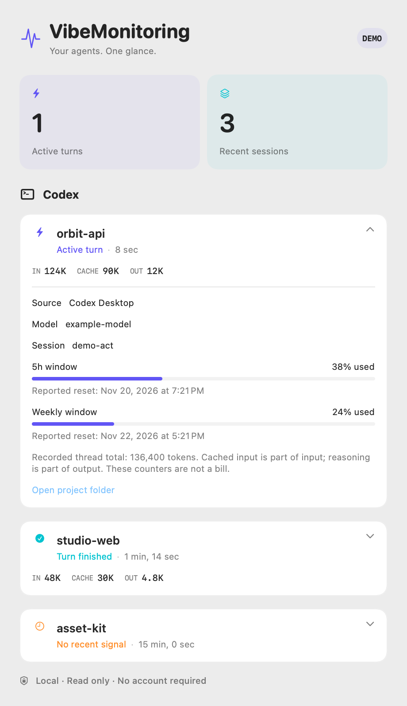

# VibeMonitoring

**Your agents. One glance.**

A native macOS menu bar app for observing local Codex, Claude Code and Cursor agent sessions. See recent activity, recorded token usage and quota reports without opening every terminal or chat.



VibeMonitoring observes Codex, Claude Code and Cursor locally and can connect to Quickping for read-only service monitoring. Quickping defaults to `https://quickping.tech`; self-hosted origins are supported. The server needs [the desktop integration endpoints](docs/quickping-integration.md).

An **experimental VPN candidate** adds subscription import, server selection and separate macOS packet-tunnel and experimental network-lock system extensions. It is not installed or activated by the normal build. Installation is gated on signing and provisioning, and on-device crash/leak checks remain outstanding. **Do not rely on the candidate for protection yet.** See [VPN setup and validation](docs/vpn.md).

## What works

- Menu bar indicator with the number of recently observed active turns.
- Session list grouped by project, with active, finished, interrupted and stale states.
- Explicit relative timestamps; completed turns keep their completion time. Recorded turn duration is shown in details when available.
- Cumulative input, cached input and output token snapshots from Codex.
- Last reported short and long usage windows, when present in the journals.
- Optional notifications when a turn observed as active finishes.
- Custom Codex home directory, refresh controls and a separate dashboard window.
- A demo mode using fictional data for screenshots and development.
- VPN candidate: expandable protection controls, menu status shield, passive receive/send rates, manual TCP availability and phased DNS/HTTPS checks. The independent network lock is experimental; device crash/startup/leak checks remain outstanding. In-place server switching is experimental and can interrupt existing connections.
- Optional Quickping sign-in through the system browser, with PKCE, explicit read-only consent and credentials in macOS Keychain.
- Quickping service status, last check results, latency and open incident counts. Failed requests preserve previous results and mark them stale.
- Optional Brave download/privacy-help links. No browser or personal browser profile is bundled or imported.

Agent monitoring requires no account, API key or server. Quickping is optional. No third-party Swift package is required.

## Run

Requires macOS 13+ and a Swift 5.9+ toolchain, available with Xcode or Command Line Tools.

```sh
git clone https://github.com/Fedorrychkov/vibe-monitoring.git
cd vibe-monitoring
./scripts/build-app.sh
open dist/VibeMonitoring.app
```

The script builds and ad-hoc signs the monitoring-only `.app`. It does not install a helper, change login items or modify system networking. Ready-made downloads, when published, are listed on [GitHub Releases](https://github.com/Fedorrychkov/vibe-monitoring/releases). Experimental builds are labeled pre-release; drafts are visible only to maintainers. See [installation, release status and source builds](docs/releases.md). The VPN candidate has a separate build command and certificate requirements in [the VPN guide](docs/vpn.md).

Distribution is through this open-source repository and GitHub Releases only. The ready-to-install format is a Developer ID-signed, notarized DMG; there is no App Store release planned. People downloading that build will not need Xcode or an Apple Developer account.

To run with fictional demo data:

```sh
open dist/VibeMonitoring.app --args --demo
```

Development and checks:

```sh
swift test
swift run vibe-monitoring-scan --demo
swift run vibe-monitoring-scan
```

The scan command prints aggregate counts only; it does not print project paths, session IDs, prompts or credentials.

## How status is determined

VibeMonitoring reads local JSONL journals under `~/.codex/sessions`, or the configured Codex home. `CODEX_HOME` is used as the initial default when inherited by the process; Settings can override it for apps launched from Finder.

| Display | Evidence |
| --- | --- |
| Active turn | A `task_started` event with no matching completion, and a local event within the last three minutes |
| Turn finished | A matching `task_complete` event |
| Interrupted | A matching `turn_aborted` event |
| Needs attention | An explicit approval, user-input or error event, if the Codex version records one |
| No recent signal | An unfinished turn whose journal stopped emitting events |
| No turn signal | The available tail contains no recognizable turn lifecycle event |

**These are observed journal states, not a process-liveness guarantee.** A crash may leave an unfinished turn behind; long model calls may also stop producing events temporarily. Neither case is automatically declared a failed agent. Not all Codex versions persist approval events, so missing activity is never guessed to mean “waiting for permission.” Cloud-only sessions that do not have local journals are not covered.

The reader examines the 40 most recently modified journal files. On first read it loads a metadata prefix and a 2 MiB activity/token tail. It also searches backward in 64 KiB blocks to recover the latest turn's lifecycle, which may start much earlier in a long journal. Subsequent refreshes read only appended bytes; large gaps trigger recovery again. It handles incomplete lines, truncation and replacement, skips symlinked journals, and bounds individual records. Unknown record types are ignored. Earlier turns outside the available tail are not reconstructed.

Codex's journal format is an internal format and can change. The parser supports the `session_meta`, `turn_context`, `event_msg` and `token_usage_record` structures observed in Codex 0.160–0.169 journals. Parser tests use synthetic examples, not exported user sessions.

### Claude Code and Cursor

Each agent can be turned off in Settings; a missing directory for an agent you do not use is not reported as a problem. Each source reads its own 40 most recent transcripts with the same bounded tail reader.

- **Claude Code** — `~/.claude/projects/<project>/<session>.jsonl` (or `$CLAUDE_CONFIG_DIR`). A user prompt starts a turn; an assistant message with `end_turn` finishes it; `[Request interrupted…]` marks it interrupted; a pending `AskUserQuestion`/`ExitPlanMode` call or a `max_tokens`/`refusal` stop shows Needs attention. Local slash commands, meta records and subagent (sidechain) transcripts are not turns. Token totals are summed per API message (input includes cache reads and writes); on a long transcript only the read tail is summed and the card says so. Permission prompts are not recorded in the transcript, so they appear as a quiet active turn.
- **Cursor** — `~/.cursor/projects/<workspace>/agent-transcripts/<id>/<id>.jsonl`. These lines have no timestamps, model or token counts. Status is inferred: a pending request or tool call is active; a reply followed by 20 s without writes, or a `turn_ended` record, is finished; an unanswered request quiet for 10 minutes shows No turn signal. The workspace folder name is resolved against existing directories.

Both formats are internal and undocumented; they were checked against Claude Code and Cursor transcripts present in November 2026.

## Tokens and costs

Token events are **cumulative snapshots**. They are replaced, not summed on every event. Cached input is part of input; reasoning tokens are part of output and are not added a second time.

Counters describe the observed thread, not “today's bill.” The app does not sum parent/subagent counters into a potentially duplicated account total. Quotas are last reported values for the selected session, not a live billing API; expired reports are labeled accordingly.

Dollar costs are intentionally not inferred from a model name or subscription plan. Provider billing and configurable, clearly labeled API-price estimates can be added when there is a reliable source and a defined accounting scope.

## Privacy

- Agent monitoring runs locally. No requests are made until Quickping is explicitly connected; saved Quickping connections resume polling every 30 seconds on launch.
- Quickping authorization and monitoring contact only the selected server. API redirects are rejected, browser cookies are not copied into API requests, and the read-only token is stored in macOS Keychain. Disconnect removes local access and attempts server revocation; if offline, the app explains how to revoke it on the website.
- No telemetry, analytics or crash-upload SDK.
- `auth.json`, API keys and subscription links are not read.
- Conversation text, command arguments and tool outputs are not displayed, persisted or uploaded. The JSONL files themselves contain these fields; the parser extracts only the metadata it needs.
- Preferences store the selected Codex directory, notification toggle and non-secret Quickping server origin in macOS UserDefaults.
- The VPN candidate stores the subscription in the user's Keychain. Before enabling a VPN configuration, the app resolves the selected server and sends its credentials to the system extension over XPC with signing requirements on both peers. The system extension writes credentials to the file-based System Keychain, accessible to its own signed code. VPN preferences contain a persistent Keychain reference, a non-secret node ID and validated server IP addresses; no subscription URLs or credential UUIDs are written there.
- Project folder names appear locally in the UI and, if enabled, finish notifications. Use `--demo` for public screenshots.

## Next modules

1. **Quickping:** finish a live browser sign-in check against a deployed server; add per-service incident history later. Current integration covers the account's first 100 active services, with explicit truncation and unknown status for overdue server checks.
2. **Network protection:** provision/notarize the candidate and complete crash, DNS/IPv6, wake, network-change and reboot checks. Provider code and status evaluation are implemented, but compile/unit tests are not leak tests.
3. **Connections:** extend the tested transport/format set after the initial plain/Base64 VLESS, VMessAEAD and Trojan paths. No assumption that another app's private configuration is an import API.
4. **Other agents:** provider-specific event adapters. Claude Code is a candidate for hooks/OpenTelemetry; unknown processes must not be given invented progress or cost data.

## Contributing

Small changes and synthetic regression tests are welcome. Do not attach real Codex, Claude Code or Cursor transcripts, account data, auth files, VPN subscriptions or private project paths to issues or pull requests. See [CONTRIBUTING.md](CONTRIBUTING.md).

MIT licensed. Independent project, not affiliated with OpenAI.
